<a href="https://keelinfra.io/cra/">
  <picture>
    <source media="(prefers-color-scheme: dark)" srcset=".github/readme/hero-dark.svg">
    
  </picture>
</a>

<p align="center">
  <a href="https://github.com/keelinfra/release-ledger/actions/workflows/ci.yml"></a>
  <a href="https://github.com/keelinfra/release-ledger/releases/latest"></a>
  <a href="https://eur-lex.europa.eu/eli/reg/2024/2847/oj"></a>
  <a href="#license"></a>
</p>

<p align="center">
  <a href="#record-each-release"><b>Record each release</b></a> &nbsp;·&nbsp;
  <a href="#watch-every-supported-release"><b>Watch every supported release</b></a> &nbsp;·&nbsp;
  <a href="#what-it-does-not-do"><b>What it does not do</b></a> &nbsp;·&nbsp;
  <a href="https://keelinfra.io/cra/"><b>keelinfra.io</b></a>
</p>

<br>

**Evidence for the EU Cyber Resilience Act, recorded by your release pipeline.**

The CRA ([Regulation (EU) 2024/2847](https://eur-lex.europa.eu/eli/reg/2024/2847/oj)) cares about every version you have shipped, for its whole support period, not only about the code on `main` today.

| From | For a product on the EU market |
|---|---|
| **11 September 2026** | an actively exploited vulnerability has to be reported within **24 hours** |
| **11 December 2027** | every product needs an **SBOM**, a stated **support period** and technical documentation kept for **10 years** |

release-ledger is two GitHub Actions:

- **record** runs when you publish a release. It attaches an SBOM and a `cra-evidence.json` to the release, and signs build-provenance and SBOM attestations for your release files.
- **monitor** runs daily. It checks every release still inside its support period against [OSV](https://osv.dev), and opens an issue when a vulnerability in one of them is listed as actively exploited by [CISA KEV](https://www.cisa.gov/known-exploited-vulnerabilities-catalog) or [ENISA's EUVD](https://euvd.enisa.europa.eu). The issue carries the Article 14 checklist: 24-hour early warning, 72-hour notification, final report.

> [!TIP]
> Standard library Python, no dependencies to install. The only action it calls is GitHub's own [`actions/attest`](https://github.com/actions/attest), pinned to a commit.

## Record each release

```yaml
name: release
on:
  release:
    types: [published]

permissions:
  contents: write       # attach the evidence to the release
  id-token: write       # sign attestations
  attestations: write

jobs:
  evidence:
    runs-on: ubuntu-latest
    steps:
      - uses: actions/checkout@v7
      # ... build your release files into dist/ ...
      - uses: keelinfra/release-ledger@<commit sha>  # v0.1.0
        with:
          support-until: "2031-12-31"
          subject-path: dist/*
          # sbom: build/bom.json   # recommended: an SBOM from your build
```

> [!IMPORTANT]
> Pin the action to the full commit SHA of a [release](https://github.com/keelinfra/release-ledger/releases), not to the tag.

Without `sbom`, it exports one from GitHub's [dependency graph](https://docs.github.com/en/code-security/supply-chain-security/understanding-your-software-supply-chain/exporting-a-software-bill-of-materials-for-your-repository). That SBOM comes from manifests, so it can miss what your build bundles and lists version ranges it cannot check. An SBOM from your build tool is more accurate, for example [CycloneDX's Maven plugin](https://github.com/CycloneDX/cyclonedx-maven-plugin) or `npm sbom --sbom-format cyclonedx`.

`cra-evidence.json` looks like this:

```json
{
  "schema": "release-ledger/v1",
  "product": "my-app",
  "version": "1.2.0",
  "repository": "https://github.com/acme/my-app",
  "commit": "4f1c…",
  "released_at": "2026-10-17T12:00:00Z",
  "support_until": "2031-12-31",
  "sbom": {"file": "bom.json", "format": "CycloneDX 1.6", "sha256": "…", "packages": 412},
  "subjects": [{"name": "my-app-1.2.0.tar.gz", "sha256": "…"}],
  "attestations": ["https://github.com/acme/my-app/attestations/…", "…"],
  "security_policy": "https://github.com/acme/my-app/blob/4f1c…/SECURITY.md"
}
```

Anyone can check a release file came unmodified from your workflow:

```sh
gh attestation verify my-app-1.2.0.tar.gz --repo acme/my-app
```

## Watch every supported release

```yaml
name: cra-monitor
on:
  schedule:
    - cron: "17 6 * * *"
  workflow_dispatch:

permissions:
  contents: read
  issues: write

jobs:
  monitor:
    runs-on: ubuntu-latest
    steps:
      - uses: keelinfra/release-ledger/monitor@<commit sha>  # v0.1.0
```

The job summary lists each supported release, how many packages were checked, and how many known and actively exploited vulnerabilities it has. The step fails when one is actively exploited (`fail-on: exploited`, or `any`, or `never`), and opens one issue per vulnerability and release, labelled `cra`.

Run it locally against any SBOM:

```sh
python3 ledger.py monitor --sbom bom.json --version 1.2.0
```

## What it does not do

> [!WARNING]
> It does not make you compliant or replace your own assessment. It records evidence and tells you when to look.

- A vulnerability in your dependencies is not always exploitable in your product. The issue starts that assessment; the 24-hour clock starts when you are reasonably sure you are affected.
- KEV and EUVD are lists of known exploitation, not complete ones.
- Only packages with an exact version can be checked; the summary shows how many were.

## Get involved

Bug reports and questions: [open an issue](https://github.com/keelinfra/release-ledger/issues). Security reports go through [SECURITY.md](SECURITY.md).

A hosted version is planned: every shipped version watched for its whole support period, alerts by email, a drafted Article 14 report and an EU evidence archive. [keelinfra.io/cra](https://keelinfra.io/cra/) has the details and a waitlist.

## License

[Apache License 2.0](LICENSE).

<br>

<p align="center">
  <a href="https://keelinfra.io"></a>
  <br>
  <sub>
    Made by <a href="https://keelinfra.io"><b>keelinfra</b></a>: tested, open-source builds for CI that can't upgrade yet.<br>
    <a href="https://github.com/keelinfra/jenkins-extended-security">Extended Security for Jenkins 2.541.x</a> &nbsp;·&nbsp;
    <a href="https://github.com/keelinfra/agent8">Agent8 for Jenkins</a> &nbsp;·&nbsp;
    <a href="https://keelinfra.io/jenkins/upgrade-matrix/">Jenkins upgrade matrix</a> &nbsp;·&nbsp;
    <a href="https://github.com/keelinfra/aix-runner">AIX Runner for GitLab</a>
  </sub>
</p>
